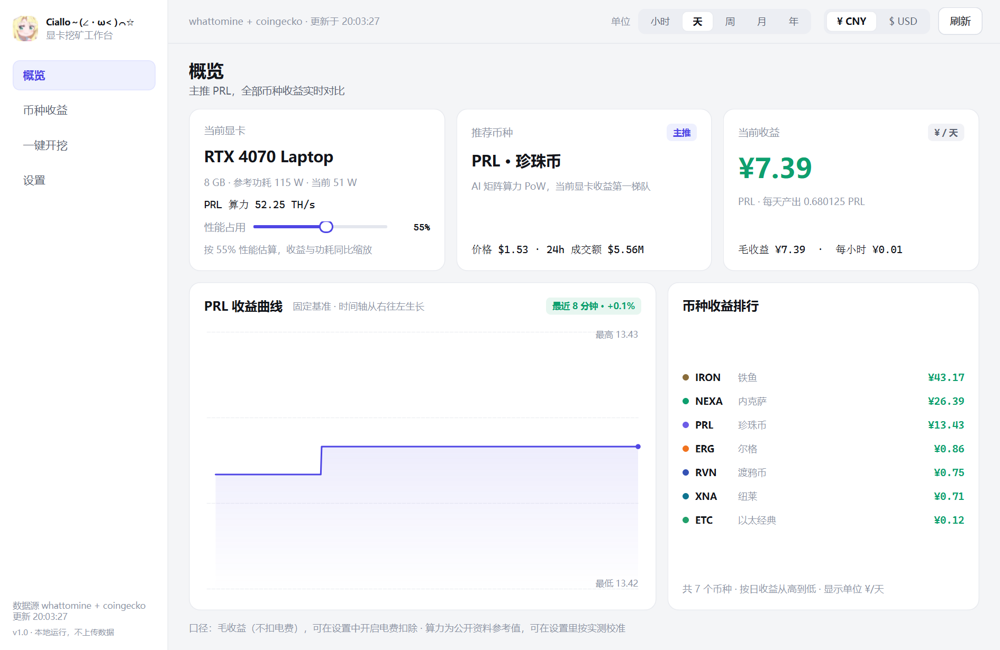

# Ciallo～(∠・ω< )⌒☆

一个本地运行的显卡收益看板 + 一键开挖工具。选币、看收益、填钱包、开挖，四步搞定。



## 下载安装

| 方式 | 文件 | 说明 |
|---|---|---|
| **一键安装（推荐）** | `CialloSetup.exe` | 双击安装到 `%LOCALAPPDATA%\Ciallo`，自动创建桌面与开始菜单快捷方式，可在「应用和功能」里卸载 |
| 绿色版 | `Ciallo.exe` | 单文件，双击即用，不写注册表 |

到 [Releases](../../releases) 页面下载最新版本。

## 快速开始

| 方式 | 操作 |
|---|---|
| 安装版 | 双击桌面「Ciallo」图标 |
| 绿色版 | 双击 `Ciallo.exe` |
| 源码运行 | 双击 `启动.bat`（需要 Python 3.11+） |

首次启动会自动拉取行情（whattomine / CoinGecko / CoinPaprika），并把缓存存到 `data/` 目录，断网也能用上一次的数据。

## 能做什么

**概览**：识别你的显卡，实时算每个币的收益，自动挑当前最赚钱的那个。

**币种收益**：全部支持币种横向对比（算力、日产出、日收益、24h 涨跌），点一行就跳到开挖页。

**一键开挖**：只要填一个钱包地址，剩下的矿池、内核、命令行全部自动生成。内核没装会自动下载。

**自定义币种**：任何不在列表里的币，填 6 个数字（算力、全网算力、出块时间、区块奖励、单价、矿池）就能加进来，用同一套公式算收益、走同一条开挖流程。

**性能占用**：0%–100% 滑块，调多少就算多少收益；勾选"自动设置功耗墙"后开挖时会用 `nvidia-smi` 把功耗限制到对应档位。

**单位切换**：右上角随时切换 小时 / 天 / 周 / 月 / 年，以及 ¥ 人民币 / $ 美元。

## 支持的开挖币种

| 币种 | 算法 | 默认内核 | 内置矿池 |
|---|---|---|---|
| PRL 珍珠币 | PearlHash | lpminer | K1Pool 中国/欧洲/美国、PearlPool |
| ETC 以太经典 | Etchash | lolMiner | K1Pool 中国/欧洲 |
| RVN 渡鸦币 | KawPow | lolMiner | K1Pool 中国/欧洲 |
| ERG / IRON / NEXA / XNA | Autolykos2 / FishHash / NexaPow / KawPow | lolMiner | 自行填写矿池地址 |

其余币种也可以挖，选「自定义矿池」填 host 和端口即可。

## 一键开挖怎么走

1. 「一键开挖」页选币种
2. 粘贴收款地址（只有一个必填项）
3. 选矿池（国内建议 K1Pool 中国节点）
4. 点「一键开挖」——没有内核会自动下载 lpminer / lolMiner / SRBMiner-Multi

运行中会显示实时算力、份额、运行时长，以及按实时算力折算的收益。

## 常见问题

**内核下载失败？** 设置里「教程与数据来源」有官方 Releases 链接，手动下载解压后，在开挖页点「选择本地内核」指定 exe 即可。

**收益和矿池显示不一样？** 看板用全网算力 × 区块奖励估算，矿池按实际提交份额结算，短时间有浮动，跑满一天再对比。

**能不能只挖一部分性能？** 拖性能滑块，或直接在驱动里锁功耗墙，看板数字会跟着变。

**会不会上传数据？** 全部本地运行，钱包地址、配置、历史都存在 `data/config.json`。

## 目录

```
Ciallo.exe            绿色版主程序（Release 附件）
CialloSetup.exe       一键安装包（Release 附件）
启动.bat              源码启动
app.py                入口
installer/setup.py    安装程序源码
minedeck/           程序本体
  catalog.py          显卡算力表 / 币种 / 矿池 / 内核
  market.py           行情数据与缓存
  profit.py           收益计算
  miners.py           内核下载与进程管理
  ui/                 界面
%LOCALAPPDATA%\Ciallo\data     配置与行情缓存（自动生成）
%LOCALAPPDATA%\Ciallo\miners   内核文件（自动下载，换版本不会重下）
```

## 数据来源

- 行情与网络数据：[whattomine](https://whattomine.com)、[CoinGecko](https://www.coingecko.com)、[CoinPaprika](https://coinpaprika.com)
- 算力参考：[hashrate.no](https://www.hashrate.no/coins/PRL/benchmarks)、[91挖](https://91wa.net/prl-pearl-gpu-overclocking-hashrate-table/)
- 矿池教程：[K1Pool](https://k1pool.org/zh/pool/pearl/how-to-start)、[F2Pool](https://f2pool.zendesk.com/hc/zh-tw/articles/59248379419417)、[PearlPool](https://pearlpool.cloud)
- 内核：[lpminer](https://pearl.luckypool.io/lpminer/)、[SRBMiner-Multi](https://github.com/doktor83/SRBMiner-Multi)、[lolMiner](https://github.com/Lolliedieb/lolMiner-releases)


